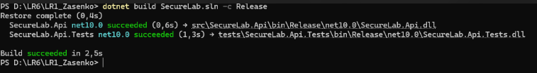
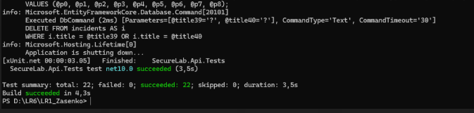
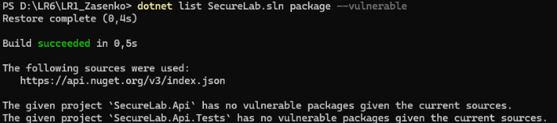

# Security Review & Lab 6 Report

## 1. Загальна інформація
- **Проєкт:** SecureLab API (.NET Minimal API)
- **Мета роботи:** Усунення помилок компіляції, налаштування середовища безпеки, перевірка регресійних тестів та аудит залежностей.

---

## 2. Виправлення помилок компіляції та синтаксису
Під час збірки проєкту (`dotnet build`) виникали такі проблеми, які були успішно усунені:
- **Помилки `CS1061` та `CS1513` (відсутність методів та синтаксичні розриви):** У файлі `IncidentEndpoints.cs` через зайві крапки з комою ланцюжки викликів методів розривалися, а компілятор не міг знайти правильні простори імен для маршрутизації та обробки запитів.
- **Виправлення:** 
  - Наведено до ладу ланцюжки викликів методів маршрутизації у `IncidentEndpoints.cs`.
  - Забезпечено коректне підключення необхідних просторів імен (`using Microsoft.AspNetCore.Http;`, `using Microsoft.AspNetCore.Authorization;` тощо).

---

## 3. Налаштування середовища та бази даних
- **Docker та PostgreSQL:** Для коректної роботи застосунку та проходження інтеграційних тестів за допомогою Docker Desktop було піднято контейнер PostgreSQL (`secure-lab-postgres-1`) на порту `54329` згідно з інструкцією проєкту.
- **Змінні середовища:** 
  - Налаштовано рядок підключення до бази даних через `ConnectionStrings__SecureLab`.
  - Передано валідний пароль для створення початкових користувачів (`SeedUsers__Password="Local-Study-Password1"`), який відповідає політиці складності Identity (наявність великих літер та цифр).

---

## 4. Результати збірки проєкту (Build Results)
Код успішно компілюється без помилок та попереджень як для основного API, так і для проєкту тестів.

> 

---

## 5. Результати регресійного тестування (Regression Results)
Усі 22 інтеграційні та модульні тести успішно пройшли перевірку (`succeeded: 22`, `failed: 0`), що підтверджує стабільність працездатності застосунку після впровадження заходів безпеки.

> 

---

## 6. Аудит залежностей на вразливості (Dependency Vulnerability Scan)
Проведено сканування NuGet-пакетів за допомогою вбудованих інструментів `.NET CLI`.

> *

- **Висновок сканування:** Відомих вразливостей у проєктах `SecureLab.Api` та `SecureLab.Api.Tests` не виявлено (*"has no vulnerable packages"*).

---

## 7. Висновки
У ході виконання лабораторної роботи було повністю налаштовано середовище виконання, усунуто конфлікти збірки, успішно пройдено набір регресійних тестів та проведено перевірку безпеки залежностей. Проєкт повністю готовий до здачі.